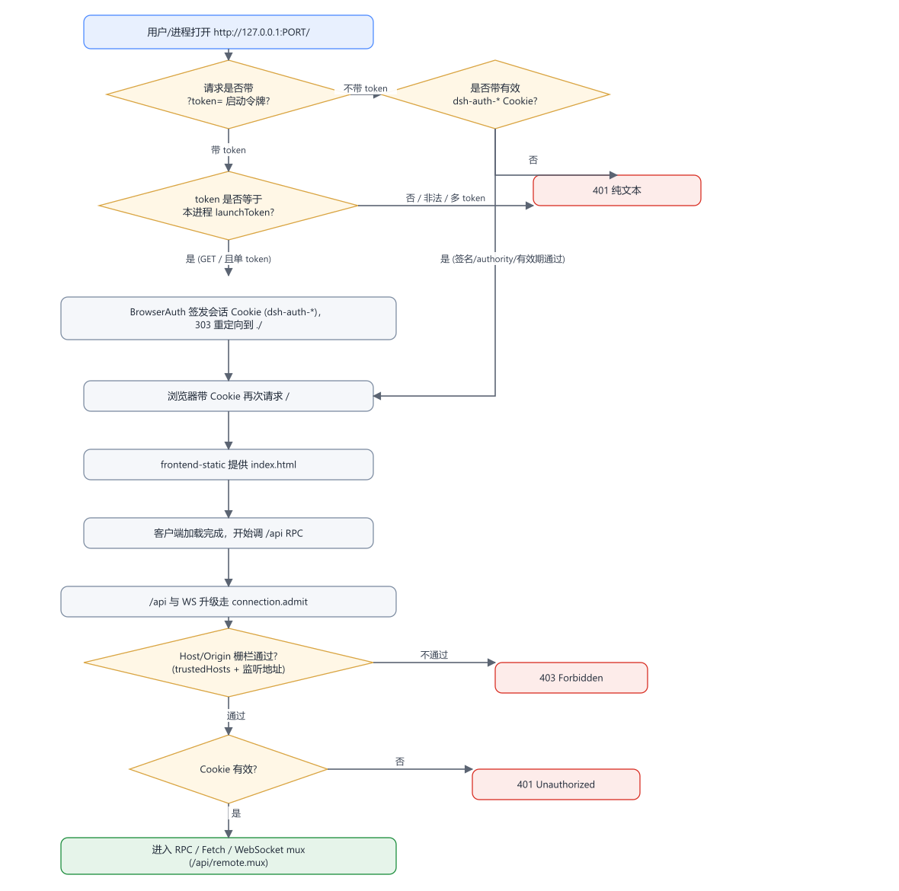
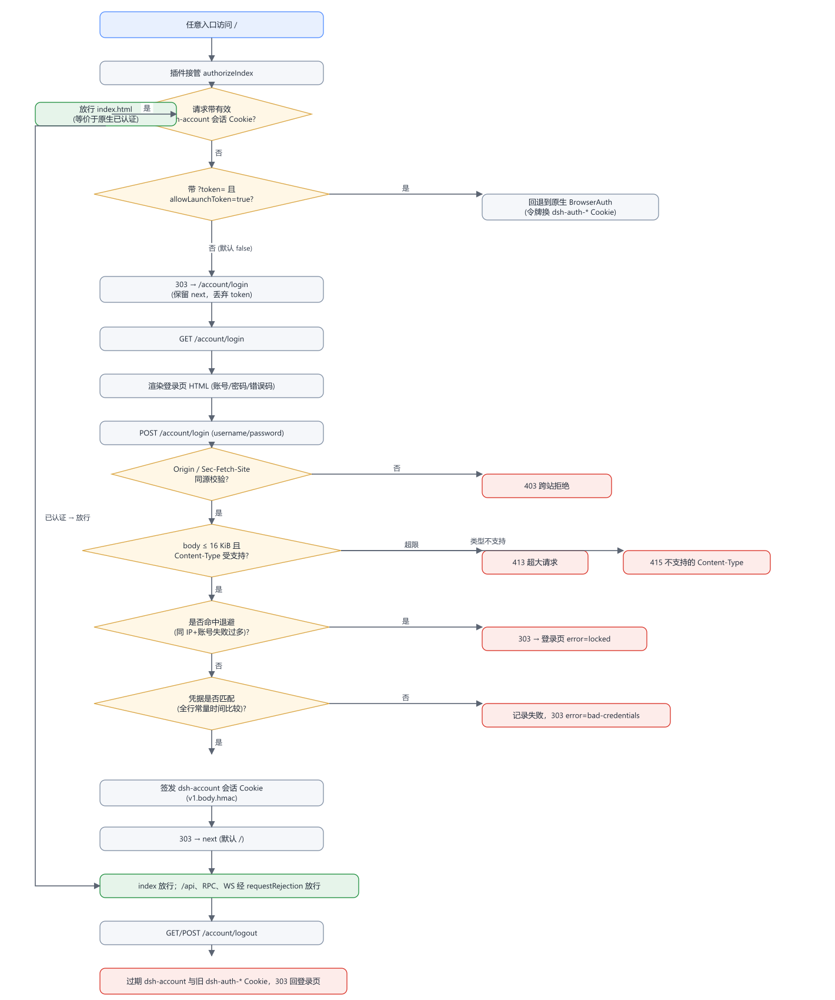
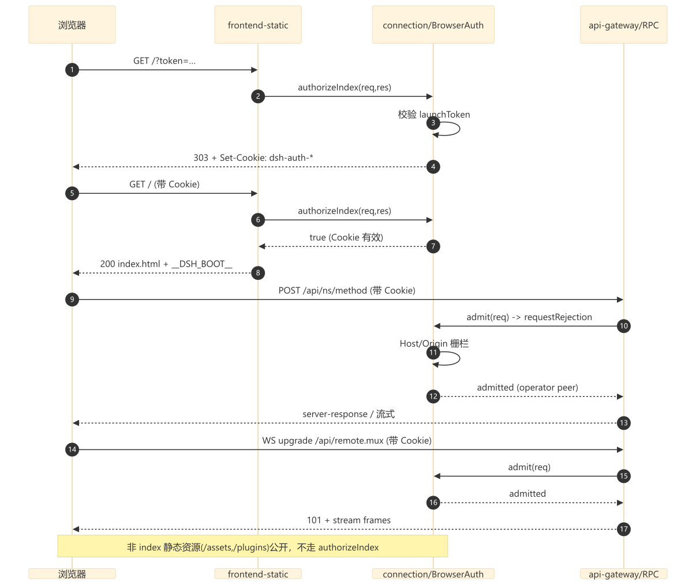
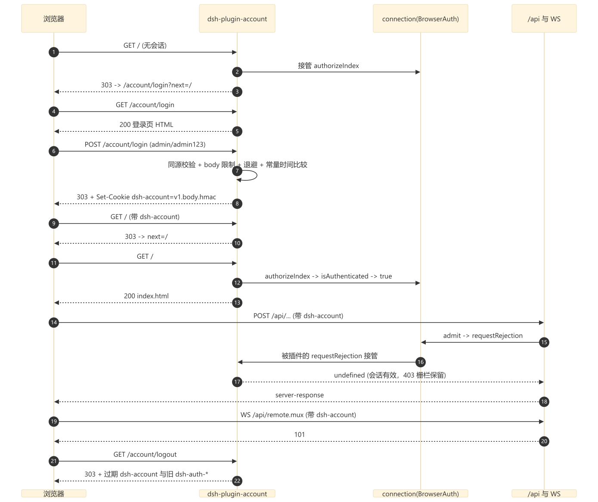
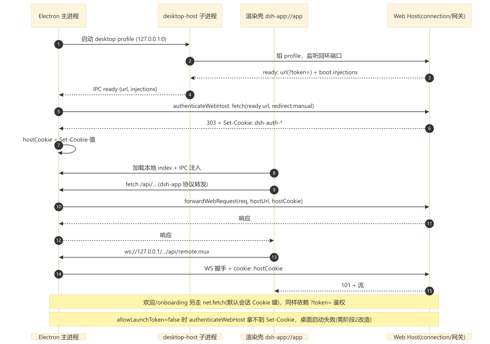
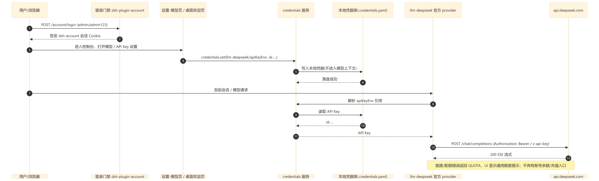

# DSH 登录改造分析与插件设计

> 状态：设计稿，尚未实施。本文整理桌面客户端（Electron）与 Web 客户端的登录实现、依赖面、改造影响、闭环方案，以及登录门禁的自定义账号密码（admin / admin123）插件设计。
>
> 第 2 层已按最新决定调整：不再登录或持有 DeepSeek 官方账号，改为登录门禁通过后录入 DeepSeek API Key。

## 结论摘要

DeepSeek Harness 里有两层相互独立的“登录”：

1. **访问门禁（access gate）**：`?token=` 启动令牌换 `dsh-auth-*` 签名 Cookie，未登录只给纯文本 `401`。它决定“谁能打开 Web UI、调用 `/api`、连接 WebSocket”。本方案把它替换为 admin / admin123 登录页。
2. **模型凭据**：目标态由“DeepSeek 官方账号（OAuth）”改为“DeepSeek API Key”。登录门禁通过后，用户在设置页或桌面欢迎页录入 API Key，走官方 provider 完成推理。

关键边界：admin / admin123 只解决“进大门”；推理能力由录入的 DeepSeek API Key 提供。不再保留账号资料、余额、赠金、充值、账号额度等官方账号 UI。

另一个关键发现：现有插件 README 中“`allowLaunchToken:false` 时桌面主窗口不受影响、显示登录页”的说法对 Electron 桌面端不成立。桌面壳的鉴权完全依赖启动令牌交换（`authenticateWebHost` 期待 `303 + Set-Cookie`），令牌被禁用后桌面端会在启动阶段直接失败。这是重新实现必须修复的问题。

## 1. 现状实现

### 1.1 第 1 层：访问门禁

由 `client-connection` 的 `BrowserAuth` 实现：

- 进程启动生成一次性 `launchToken`，拼成 `http://127.0.0.1:<port>/?token=…`。
- `authorizeIndex`：根路径带正确 token 时，签发 `dsh-auth-<sha256(authority)>` Cookie 并 `303 → ./`；带有效 Cookie 就放行 index；否则 `401`。
- `requestRejection` / `admit`：先做 Host/Origin 栅栏（403），再验 Cookie（401）。`/api`、WebSocket mux（`/api/remote.mux`）、`open-in-app` 路由都走它。

关键文件：

- `../../../packages/client/connection/src/browser-auth.ts`
- `../../../packages/client/connection/src/rpc-host.ts`
- `../../../packages/host/frontend-static/src/index.ts`
- `../../../packages/api/gateway/src/index.ts`

### 1.2 第 2 层：模型凭据（目标态为 API Key）

当前代码里的 DeepSeek 官方账号体系，改造后将被停用或移除：

- `deepseek-account` 服务定义与 `deepseek-account-platform` OAuth 实现（PKCE、`/oauth/callback`、grant 落盘、profile/balance/bonus 查询、logout）。
- `account-controller` 的 `account/*` RPC。
- `llm-deepseek-account` 账号计费模型路由。
- `web-search-deepseek` 的账号鉴权分支。
- `ui-settings-account` 的账号资料、余额、赠金、充值、额度提示、SignInDialog、Platform 内嵌页。
- 桌面 `platform-view`、`account-backend`、`preload-platform-account`，以及欢迎页的账号登录分支。
- `product-analytics` 对 `deepseekAccount.getDeviceIdentity()` 的依赖。
- 事件 `deepseek-account/session-expired`、`deepseek-account/model-sign-in-required`、`deepseek-account/signed-out`，以及账号任务取消逻辑。

目标态保留的推理凭据链：

- `llm-deepseek`（`deepseek-official` 官方 API Key 路由）。
- 设置“模型”页与桌面欢迎页的 API Key 表单。
- `credentials` / `credentials-local` 本地凭据库（`apiKeyEnv` 引用）。
- 模型请求注入 `x-api-key` 与 `Authorization: Bearer`。

### 1.3 桌面客户端的两条鉴权通道

桌面壳不让渲染进程接触 token，而是：

1. **主窗口**：主进程 `authenticateWebHost(ready.url)` 用令牌换 Cookie 存为 `hostCookie`，之后 `forwardWebRequest` 与 WebSocket 拦截器把该 Cookie 附加到所有转发请求。见 `../../../apps/desktop/src/web-document.ts` 与 `../../../apps/desktop/src/main.ts`。
2. **欢迎/onboarding 窗口**：`connectDesktopWelcome` 用 Electron `net.fetch`（默认会话 Cookie 罐）先访问带 token 的 URL，再调 RPC。见 `../../../apps/desktop/src/welcome-backend.ts`。

两条通道都依赖“启动令牌 URL 本身能鉴权”，所以 `allowLaunchToken:false` 会同时打断它们。

## 2. 依赖清单

### 依赖第 1 层（访问门禁）

| 功能 | 依赖方式 |
| --- | --- |
| 整个 Web UI（index.html） | `authorizeIndex` |
| 所有 `/api` RPC、Fetch 路由 | `requestRejection` / `admit` |
| WebSocket 流 mux（`/api/remote.mux`） | `admit` |
| 桌面主窗口的 HTTP/WS 转发 | `hostCookie` |
| 桌面欢迎窗口的 RPC | `net.fetch` Cookie |
| `open-in-app` 宿主路由 | `requestRejection` |
| 启动打印 URL、默认浏览器打开、`DSH_WEB_URL` | 令牌 URL |

静态资源（`/assets/*`、`/plugins/*`、HMR SSE 等）公开，不属于门禁管辖。

### 第 2 层改造后保留的依赖

| 功能 | 依赖方式 |
| --- | --- |
| 官方 DeepSeek 模型推理 | `llm-deepseek` 读取 API Key |
| DeepSeek 网页搜索 | `web-search-deepseek` 使用 API Key（删除账号鉴权分支） |
| API Key 录入（Web 设置 + 桌面欢迎页） | `credentials.set(apiKeyEnv)` |
| 额度错误提示 | Chat 通用 `QUOTA` 提示（不再有 `ACCOUNT_QUOTA`） |
| 产品埋点身份 | `anonymous-user-id`（不再读取账号 device/user id） |

被移除：账号资料、余额、赠金、充值、usage/top-up 内嵌页、账号登录/登出、账号计费模型路由、账号鉴权搜索、`ACCOUNT_QUOTA` 提示。

## 3. 改造影响

### 只替换第 1 层

- 好的：浏览器端从“裸 401”变成登录页；`/api`、WS、index 全部被 admin / admin123 会话接管；`?token=` 失效。
- 坏的：桌面 Electron 启动失败（见 1.3）；`DSH_WEB_URL`/默认浏览器打开失效；`open-in-app` 里依赖令牌 URL 的路径失效；欢迎/onboarding 失效；相关 e2e 与快照测试要跟着改。

### 第 2 层改为 API Key

- 移除 OAuth 账号登录、`/oauth/callback`、grant 落盘、profile/balance/bonus 查询、logout。
- 模型选择器不再有“DeepSeek 账号”分组，只保留官方 API Key 与自定义 provider。
- 桌面欢迎页从“登录账号或填 API Key”变为“填 API Key”（叠加第 1 层门禁登录）。
- 产品埋点身份回退到匿名安装 ID。
- 不再有账号余额/充值/赠金入口；API Key 额度耗尽由模型返回 `QUOTA`，走通用额度提示。
- `web-search-deepseek` 删除账号鉴权分支，搜索只走 API Key。

## 4. 流程图与时序图

### 第 1 层：访问门禁

**图 1：原生 DSH 门禁流程图**

**图 2：admin / admin123 插件登录流程图**

**图 3：浏览器端原生时序图**

**图 4：浏览器端插件登录时序图**

**图 5：桌面 Electron 客户端时序图**

### 第 2 层：登录后录入 API Key

**图 6：API Key 录入与推理鉴权时序图**

## 5. 闭环方案（分阶段）

### 阶段 1：纯插件，Web 端门禁闭环

重写 `dsh-plugin-account` 宿主插件，只替换第 1 层门禁。验证链：裸访问 `/` → 303 登录页 → admin / admin123 → 拿到会话 Cookie → 进入 UI、`/api`、WS 全通 → 登出 → 令牌 URL 不再自动登录。

### 阶段 2：桌面端门禁闭环（小改桌面代码）

让 Electron 壳参与登录：

- 主进程 `authenticateWebHost` 失败后打开本地登录窗口，把 admin / admin123 POST 到宿主 `/account/login`，从 303 响应的 `set-cookie` 里截取 `dsh-account` Cookie，存入 `hostCookie` 并供 `forwardWebRequest` / WS 转发。
- `connectDesktopWelcome` 改为显式携带该 Cookie。
- 涉及 `../../../apps/desktop/src/main.ts`、`../../../apps/desktop/src/web-document.ts`、`../../../apps/desktop/src/welcome-backend.ts`，以及一个本地登录 preload/页面。

### 阶段 3：第 2 层改为 API Key

- 停用或移除 `deepseek-account` / `deepseek-account-platform` / `account-controller` / `llm-deepseek-account` / `ui-settings-account` 的账号部分。
- 保留官方 provider `llm-deepseek` 与 API Key 录入 UI。
- 桌面欢迎页改为“API Key 录入 + 语言/分析设置”，移除账号登录分支。
- 验证链：登录 admin / admin123 → 录入 API Key → 发起对话 → 官方 provider 用 `x-api-key` / `Authorization: Bearer` 调 `api.deepseek.com` → 成功；未录 Key 时报“缺少凭据”；界面不再出现账号/余额/充值入口。

### 阶段 4：可选，代码清理

删除已停用的账号相关包与事件，收敛 dead code；与阶段 3 可拆成独立 PR。

## 6. 设计

### 6.1 第 1 层插件（重新整理和实现）

基本骨架沿用现有版，重组为更规范的宿主插件，并修掉桌面端缺口：

- **定位**：纯宿主（node 端）插件，零依赖、纯 ESM，不需要重构建 web 产物；继续放 `plugins/dsh-plugin-account`。
- **接口**：`inject: ['connection', 'webServer']`；路由 `/account/login`（GET/POST）、`/account/logout`、`/account/api/session`；接管 `authorizeIndex` 与 `requestRejection`。
- **配置**：`users`（默认 `admin/admin123`）、`allowLaunchToken`、`sessionDays`、`sessionFile`、`cookieName`、`title`、`maxAttempts`、`lockoutSeconds`、`publicBasePath`。用 schemastery/zod 做配置校验。
- **安全**：HMAC-SHA256 会话 Cookie、`HttpOnly/SameSite=Strict/Path=/`、Host 绑定防跨 authority 重放、登录/登出同源校验防 CSRF、常量时间凭据比较、失败退避（翻倍、封顶 15 分钟）、body 16 KiB 上限、密钥独占创建持久化（不可写时降级进程内密钥并告警）。
- **生命周期**：dispose 时恢复 `authorizeIndex` / `requestRejection` 原方法、卸载路由；避免热重载叠加包装。
- **接入方式二选一**：
  - P0（推荐，本次范围）：继续 monkey-patch `connection` 两个方法，把“保存/恢复原方法”做成幂等、可重入，并配套宿主级冒烟测试。
  - P1（更工程化，但动核心包）：给 `client-connection` 增加正式扩展点（如 `connection/authorize-index`、`connection/request-admission` waterfall），插件只注册监听。代价是同步 `docs/architecture.md`、TS/Python SDK 快照和类型声明，影响面大。
- **测试**：宿主级单测覆盖登录/登出/会话/Cookie/CSRF/退避/超大 body；桌面端加 `authenticateWebHost` 失败后的登录握手测试；真实 `dsh web` 端到端冒烟。
- **文档**：README 把“Web 端 vs 桌面端”两条路径分开写，明确 `allowLaunchToken:false` 对桌面端的影响和阶段 2 的接入要求。

### 6.2 第 2 层调整为 API Key

停用清单：

- `deepseek-account`、`deepseek-account-platform`、`account-controller`、`llm-deepseek-account`。
- `ui-settings-account` 的账号部分、`platform-view`、`account-backend`、`preload-platform-account`、欢迎页账号登录分支。
- `web-search-deepseek` 的账号鉴权分支、`product-analytics` 的账号身份读取。
- 账号相关事件与账号任务取消逻辑。

保留清单：

- `llm-deepseek`（`deepseek-official` 官方 API Key 路由）。
- 设置“模型”页与桌面欢迎页的 API Key 表单。
- `credentials` / `credentials-local`（`apiKeyEnv` 引用，密钥不进入模型上下文与会话日志）。
- Chat 通用 `QUOTA` 提示。

存储与隔离：

- API Key 沿用现有 `credentials.set(apiKeyEnv, key)` 写入本地凭据库，配置与日志只出现引用名，不出现明文密钥。
- 桌面渲染层不直接接触密钥；保存与读取都在 Host 侧完成。

## 7. 验收标准

- Web 门禁：未登录访问根路径被 303 到登录页；错误密码被拒；admin / admin123 登录成功；登录后 `/api` 与 WS 正常；登出后会话失效；`?token=` 不再自动放行。
- 桌面门禁：主窗口和欢迎窗口均通过 admin / admin123 完成鉴权；登出后回到登录页；不依赖启动令牌。
- API Key：登录后可录入 Key 并成功发起官方 provider 推理；未录 Key 时报“缺少凭据”；界面不再出现账号登录、资料、余额、充值、赠金入口。
- 回滚：卸载插件或恢复 profile patch 后，原生 `dsh-auth-*` 流程恢复；无残留路由或包装。
- 安全：跨 authority Cookie 重放被拒；CSRF 被拒；连续失败触发退避；API Key 不进入模型上下文与会话日志。

## 8. 待确认问题

1. **移除方式**：第 2 层账号体系是先只从 profile bundle 停用相关插件行（可回滚，推荐），还是同时删除对应包代码？
2. **API Key 入口**：Web 设置“模型”页与桌面欢迎页都保留 API Key 录入，还是只保留一处？
3. **桌面欢迎页**：在第 1 层强制登录后，欢迎页是否只保留“API Key + 语言/分析设置”，不再承担账号登录？
4. **接入方式与包位置**：第 1 层插件用 P0（monkey-patch，推荐）还是 P1（改核心包扩展点）；插件继续放 `plugins/dsh-plugin-account` 还是并入 monorepo 工作区？
